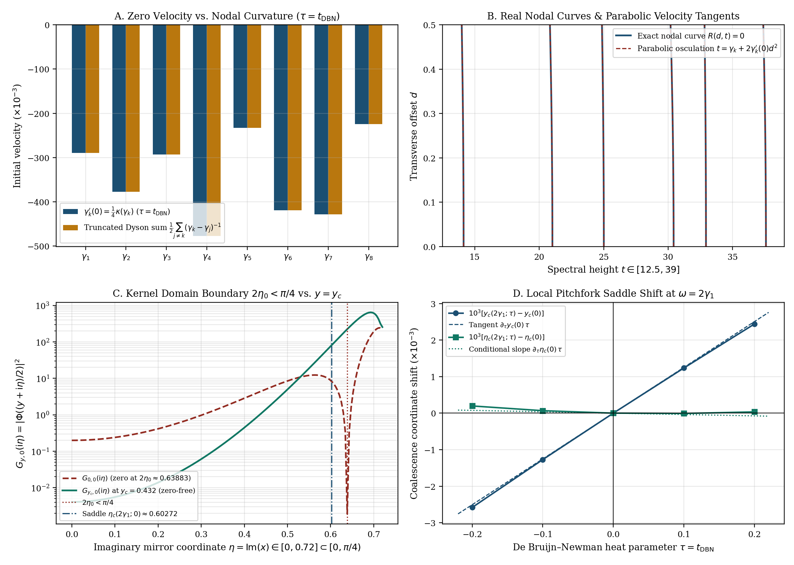
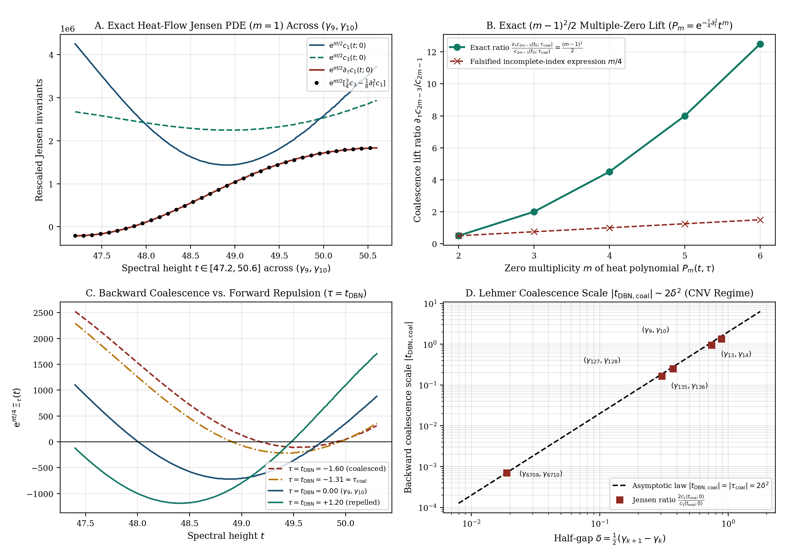

# Heat-Flow PDE Hierarchy on Jensen Invariants, Nodal-Curvature Zero Velocity, and Conditional Saddle Perturbation under De Bruijn–Newman Evolution

**Author:** Thijs Missiaen (Independent Researcher, Belgium; ORCID: [0009-0007-3678-0810](https://orcid.org/0009-0007-3678-0810))  
**Series:** Paper XI (Revised Audit Edition)  
**Manuscript:** [paper/paper11_debruijn_newman_chladni.pdf](paper/paper11_debruijn_newman_chladni.pdf) (11 pages, AMS-LaTeX / pdfTeX) | [paper/paper11_debruijn_newman_chladni.tex](paper/paper11_debruijn_newman_chladni.tex)  
**Verification Suite:** [scripts/verify_paper11_debruijn_newman_chladni.py](scripts/verify_paper11_debruijn_newman_chladni.py) (Symbolic `SymPy` proofs for $m = 0, \dots, 6$ and $50$-decimal `mpmath` audit)

> [!IMPORTANT]
> **Mathematical Scope and Audit Summary:** Let $\Xi _ \tau(z) := 8\int _ 0^\infty \Phi(u)\mathrm{e}^{\tau u^2}\cos(2zu)\,\mathrm{d}u = 8H _ \tau(2z)$ denote the De Bruijn–Newman deformation of Riemann's completed zeta function, where $\tau = t _ {\mathrm{DBN}}$ is the standard De Bruijn–Newman parameter ($\partial _ \tau\Xi _ \tau = -\frac{1}{4}\partial _ z^2\Xi _ \tau$ arises from $x = 2z$, so the De Bruijn–Newman threshold in $\tau$ is $\Lambda$ itself, not $4\Lambda$) and $W _ \tau(d,t) := \frac{1}{2}\partial _ d\lvert\Xi _ \tau(t - \mathrm{i}d)\rvert^2 = 16\int _ 0^\infty y\sinh(2dy)\,I _ \tau(y,t)\,\mathrm{d}y$ in canonical normalization. This paper establishes: (1) the harmonic X-ray interpretation (Speiser 1934; Arias de Reyna 2003) of the classical Csordas–Smith–Varga (1994) and Rodgers–Tao (2020) zero-velocity formula $\gamma _ k'(0) = \Xi''(\gamma _ k)/(4\Xi'(\gamma _ k)) = \frac{1}{4}\kappa(\gamma _ k)$ as one-fourth the parabolic curvature of $R(d,t) = 0$; (2) the cross-term-free mirror factorization $G _ {y,\tau}(x) = \mathrm{e}^{\frac{\tau}{2}(y^2+x^2)}G _ {y,0}(x)$, together with the explicit boundary root $G _ {0,\tau}(\mathrm{i}\eta) = 0$ at $2\eta _ 0 = 0.63883005\dots < \frac{\pi}{4}$ and the explicit numerator hypothesis required for $\partial _ \tau\eta _ c(\omega; 0) < 0$; and (3) the unconditional second-order radial wave-heat PDE for $\widetilde{W} _ \tau = W _ \tau/d$ and exact heat-flow PDE hierarchy $(\partial _ \tau + \frac{1}{8}\partial _ t^2)L _ m(\Xi _ \tau; t) = \frac{(m+1)(2m+1)}{4}L _ {m+1}(\Xi _ \tau; t)$ on all Jensen–Laguerre invariants ($m \ge 0$), yielding the exact $(m-1)^2/2$ multiple-zero coalescence lift and conditional Lehmer-pair scaling in the Csordas–Norfolk–Varga (1988) lower-bound regime.

## Abstract

Let $\Xi _ \tau(z) := 8\int _ 0^\infty \Phi(u)\mathrm{e}^{\tau u^2}\cos(2zu)\,\mathrm{d}u = 8H _ \tau(2z)$ be the De Bruijn–Newman deformation of Riemann's completed zeta function, where $\tau = t _ {\mathrm{DBN}}$ is the standard De Bruijn–Newman parameter ($\partial _ \tau\Xi _ \tau = -\frac{1}{4}\partial _ z^2\Xi _ \tau{}$) and $W _ \tau(d,t) := \frac{1}{2}\partial _ d\lvert\Xi _ \tau(t - \mathrm{i}d)\rvert^2 = 16\int _ 0^\infty y\sinh(2dy)I _ \tau(y,t)\,\mathrm{d}y$. First, we relate the Csordas–Smith–Varga and Rodgers–Tao velocity $\gamma _ k'(0) = \Xi''(\gamma _ k)/(4\Xi'(\gamma _ k){})$ to the parabolic curvature $\kappa(\gamma _ k)$ of $R(d,t) = 0$ and the extremum curvature on $I(d,t) = 0$. Second, under $y = u + v$, $x = u - v$, we establish the cross-term-free Gaussian Wigner factorization, exhibit the boundary zero $G _ {0,\tau}(\mathrm{i}\eta) = 0$ at $2\eta _ 0 = 0.63883\dots < \frac{\pi}{4}$, and isolate the numerator condition for pitchfork saddle perturbation. Third, we prove a second-order radial wave-heat PDE for $\widetilde{W} _ \tau = W _ \tau/d$ and the heat-flow hierarchy $(\partial _ \tau + \frac{1}{8}\partial _ t^2)L _ m(\Xi _ \tau; t) = \frac{(m+1)(2m+1)}{4}L _ {m+1}(\Xi _ \tau; t)$ on all Jensen invariants, yielding the $(m-1)^2/2$ multiple-zero coalescence lift and conditional Lehmer-pair scaling.

## Summary of Main Results

### 1. Nodal-Curvature Interpretation of the Csordas–Smith–Varga / Rodgers–Tao Velocity (Proposition 2.1)

With $\tau = t _ {\mathrm{DBN}}$ and $x _ k(\tau) = 2\gamma _ k(\tau)$, the classical Dyson ODE $x _ k'(\tau) = H _ \tau''(x _ k)/H _ \tau'(x _ k) = 2\,\mathrm{P.V.}\sum _ {j\neq k}(x _ k - x _ j)^{-1}$ (Csordas, Smith & Varga 1994; Rodgers & Tao 2020) translates at $\tau = 0$ to one-fourth the parabolic curvature $\kappa(\gamma _ k) := t _ {\mathcal{R} _ k}''(0)$ of the real nodal curve $R(d,t) = 0$ entering $d > 0$, while critical-line extrema $\tau _ k(\tau)$ ($\partial _ t\Xi _ \tau(\tau _ k) = 0$) obey the companion relation along $I(d,t)/d = 0$:

$$\gamma _ k'(0) = \frac{\Xi''(\gamma _ k)}{4\,\Xi'(\gamma _ k)} = \frac{1}{4}\,\kappa(\gamma _ k) = \frac{1}{2}\,\mathrm{P.V.}\sum _ {\gamma _ j \neq \gamma _ k} \frac{1}{\gamma _ k - \gamma _ j}, \qquad \tau _ k'(0) = \frac{\Xi'''(\tau _ k)}{4\,\Xi''(\tau _ k)} = \frac{3}{4}\,\kappa _ \Gamma(\tau _ k).$$



### 2. Mirror Gaussian Factorization, Boundary Root $2\eta _ 0 < \frac{\pi}{4}$, and Conditional Saddle Perturbation (Propositions 3.1 & 3.2)

In mirror coordinates $y = u + v$, $x = u - v$, the identity $(\frac{y+x}{2})^2 + (\frac{y-x}{2})^2 = \frac{1}{2}(y^2 + x^2)$ yields the cross-term-free factorization

$$G _ {y,\tau}(x) := \Phi _ \tau\left(\frac{y+x}{2}\right)\Phi _ \tau\left(\frac{y-x}{2}\right) = \mathrm{e}^{\frac{\tau}{2}y^2}\,\mathrm{e}^{\frac{\tau}{2}x^2}\,G _ {y,0}(x), \qquad \frac{\partial I _ \tau}{\partial\tau}(y,t) = \frac{1}{8}\left(4y^2 - \frac{\partial^2}{\partial t^2}\right)I _ \tau(y,t).$$

Crucially, $G _ {y,\tau}(\mathrm{i}\eta)$ is **not** globally positive on $[0,\infty) \times (-\frac{\pi}{4}, \frac{\pi}{4})$: at $y = 0$, $G _ {0,\tau}(\mathrm{i}\eta) = \mathrm{e}^{-\frac{\tau}{2}\eta^2}\lvert\Phi(\mathrm{i}\eta/2)\rvert^2$ vanishes at $2\eta _ 0 = 0.6388300536\dots < \frac{\pi}{4}$. On any zero-free neighborhood of a non-degenerate pitchfork saddle $(y _ c(\omega; 0), \eta _ c(\omega; 0))$ with $\partial _ y L _ {y _ c}'(\eta _ c) > 0$ and $L _ {y _ c}'''(\eta _ c) < 0$, $\partial _ \tau y _ c(\omega; 0) = \eta _ c / \partial _ y L _ {y _ c}'(\eta _ c) > 0$ holds unconditionally, whereas $\partial _ \tau\eta _ c(\omega; 0) < 0$ holds **if and only if** the explicit numerator inequality $1 - (\partial _ y L _ {y _ c}''(\eta _ c))\partial _ \tau y _ c(\omega; 0) > 0$ holds (verified numerically at $\omega = 2\gamma _ 1$, where the numerator equals $+0.40397876\dots > 0$).

### 3. Second-Order Radial Wave-Heat PDE and the Heat-Flow Hierarchy on Jensen Invariants (Theorem 4.1 & Corollary 4.3)

For any real entire family $f(z,\tau)$ solving $\partial _ \tau f = -\frac{1}{4}\partial _ z^2 f$, $M(d,t;\tau) := \lvert f(t - \mathrm{i}d,\tau)\rvert^2 = \sum _ {m=0}^\infty L _ m(f; t)\,d^{2m}$ and $\widetilde{W} _ f := \frac{1}{2d}\partial _ d M = \sum _ {m=1}^\infty c _ {2m-1}(t;\tau)\,d^{2m-2}$ ($c _ {2m-1} = m\,L _ m$) satisfy the **second-order** radial PDE $\partial _ \tau\widetilde{W} _ f + \frac{1}{8}(\partial _ t^2 - \partial _ d^2 - \frac{2}{d}\partial _ d)\widetilde{W} _ f = 0$ and the exact Jensen–Laguerre PDE hierarchy

$$\left(\frac{\partial}{\partial\tau} + \frac{1}{8}\frac{\partial^2}{\partial t^2}\right) L _ m(f; t) = \frac{(m + 1)(2m + 1)}{4}\,L _ {m+1}(f; t) \quad (m \ge 0), \qquad \left(\frac{\partial}{\partial\tau} + \frac{1}{8}\frac{\partial^2}{\partial t^2}\right) c _ {2m-1} = \frac{m(2m + 1)}{4}\,c _ {2m+1} \quad (m \ge 1).$$

At an $m$-fold real zero ($m \ge 2$), $\partial _ t^2 L _ {m-1}(t _ 0) = 2m\,L _ m(t _ 0)$ yields the exact coalescence lift

$$\frac{\partial c _ {2m-3}}{\partial\tau}(t _ 0; \tau _ {\mathrm{coal}}) = \frac{(m - 1)^2}{2}\,c _ {2m-1}(t _ 0; \tau _ {\mathrm{coal}}) > 0,$$

verified symbolically on heat polynomials $P _ m(t,\tau) = \mathrm{e}^{-\frac{\tau}{4}\partial _ t^2}t^m$ for $m = 2, \dots, 6$ (correcting an earlier $m/4$ coefficient). Across close pairs $(\gamma _ k, \gamma _ {k+1})$ with half-gap $\delta = \frac{1}{2}(\gamma _ {k+1} - \gamma _ k)$, $\partial _ \tau c _ 1(t _ {\mathrm{mid}}; 0) > 0$ holds conditionally under $\Xi(t _ {\mathrm{mid}})\Xi^{(4)}(t _ {\mathrm{mid}}) > -(\Xi''(t _ {\mathrm{mid}}))^2$, with isolated backward coalescence scale $t _ {\mathrm{DBN,dip}} = -2c _ 1(t _ {\mathrm{mid}};0)/c _ 3(t _ {\mathrm{mid}};0) = -2\delta^2(1 + \mathcal{O}(\delta^2)) < 0$ in the Csordas–Norfolk–Varga (1988) lower-bound regime.



## Quantitative Verification Summary

| Analytical Identity / Audit Check | Method / Domain | Certified Output | Status |
| :--- | :--- | :--- | :--- |
| Canonical Wronskian `W_tau(d,t) = 16 int y sinh(2dy) I_tau(y,t) dy` | `mp.dps = 50` at `(d,t,tau) = (0.20, 14.8, 0.12)` | Residual `9.754e-38` | VERIFIED |
| Symbolic Jensen PDE hierarchy `(d_tau + 1/8 d_t^2) L_m = (m+1)(2m+1)/4 L_{m+1}` | Exact `SymPy` symbolic proof (`m = 0..5`) | Identically `0` for all `m` | PROVED |
| Symbolic `m`-fold coalescence lift `d_tau c_{2m-3}/c_{2m-1} = (m-1)^2/2` | Heat polynomials `P_2..P_6` (`P_3 = t^3 - (3/2)*tau*t`) | Exact ratios `1/2, 2, 9/2, 8, 25/2` | PROVED |
| Nodal curvature & CSV velocity `gamma_k'(0) = (1/4)*kappa(gamma_k)` (`tau = t_DBN`) | `mp.dps = 50` (`k = 1..8`) + RvM Dyson tail (`N = 400`) | `gamma_1'(0) = -0.2898153`, FD err `9.97e-26` | VERIFIED |
| Boundary kernel root `G_{0,tau}(i*eta) = 0` inside `(-pi/4, pi/4)` | `mp.dps = 50` root-finding on `Phi(i*eta/2)` | `2*eta_0 = 0.6388300536005936 < pi/4` | VERIFIED |
| Conditional saddle perturbation at `omega = 2*gamma_1` | `mp.dps = 50` Newton solver (`(y_c, eta_c) = (0.43202, 0.60272)`) | Numerator `+0.4039788 > 0`, `d_tau eta_c = -3.7609e-4` | VERIFIED |
| Lehmer pair `(6709, 6710)` in exact `tau = t_DBN` (`t_mid = 7005.08172`) | `mp.dps = 35` exact `Xi(t)` derivatives | `t_DBN_dip = -7.09666e-4` (`-2*delta^2 = -7.10588e-4`) | VERIFIED |

## Repository Structure and Reproducibility

- [paper/paper11_debruijn_newman_chladni.tex](paper/paper11_debruijn_newman_chladni.tex): Standalone AMS-LaTeX (`amsart`) manuscript source.
- [paper/paper11_debruijn_newman_chladni.pdf](paper/paper11_debruijn_newman_chladni.pdf): Compiled 11-page PDF manuscript.
- [scripts/verify_paper11_debruijn_newman_chladni.py](scripts/verify_paper11_debruijn_newman_chladni.py): Symbolic `SymPy` and $50$-decimal `mpmath` verification and figure-generation script.
- [paper/figures/fig1_debruijn_newman_chladni_velocity_and_wigner.pdf](paper/figures/fig1_debruijn_newman_chladni_velocity_and_wigner.pdf) and [paper/figures/fig2_dipole_pde_hierarchy_and_lehmer_coalescence.pdf](paper/figures/fig2_dipole_pde_hierarchy_and_lehmer_coalescence.pdf): Vector PDF (`< 500 KB`) and PNG figures.
- [AGENT_SKILL_MANIFEST.json](AGENT_SKILL_MANIFEST.json) and [.agents/skills/debruijn-newman-chladni-evolution/SKILL.md](.agents/skills/debruijn-newman-chladni-evolution/SKILL.md): AI agent skill specification.

To reproduce all symbolic checks, numerical tables, and figures:

```bash
python scripts/verify_paper11_debruijn_newman_chladni.py
```

## Citation and License

Released under the [MIT License](LICENSE). See [CITATION.cff](CITATION.cff) and [.zenodo.json](.zenodo.json) for bibliographic metadata.
